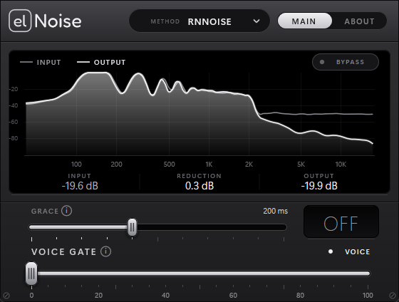

# elNoise: microphone noise suppression (VST3)

**Clean microphone audio for Windows in one plugin: Speex, RNNoise and RNNoise Lite.**
Works in Elgato **Wave Link**, OBS (via VST hosts) and any other VST3 host. Lightweight, built to run fine on weak PCs.


## Why

OBS has built-in noise suppression (Speex and RNNoise), but only inside OBS. elNoise puts the same engines, plus the
newest RNNoise models, into a VST3 you can use anywhere, for example as a microphone effect in Wave Link, so you get
the same clean mic in calls, Discord and games.

## Engines

Pick the engine with the **METHOD** selector at the top.

| Engine | Best for | CPU (one channel) |
|---|---|---|
| **Speex** | Very light, classic suppression of steady hiss and hum. Same algorithm as OBS "Speex". | ~0.2% of a core |
| **RNNoise** | Best quality: neural network (RNNoise v0.2, full model) that also removes fans, keyboards, background noise. | ~2% of a core |
| **RNNoise Lite** | Almost as good as RNNoise, noticeably lighter (v0.2 little model). | ~1.2% of a core |

RNNoise needs a **48 kHz** session (like most RNNoise plugins). Speex works at any sample rate.



## Features

- **Speex:** adjustable **Suppression Level** 0 to -60 dB (default -30), like the OBS filter
- **RNNoise / RNNoise Lite:** **Voice Gate**: the neural network's voice-activity score drives an optional gate
  (**threshold**, 0 = off, and **grace period** so word endings are not cut). A live meter shows how sure the model is
  that it hears a voice
- **Bypass** button (crossfaded, latency stays constant, also exposed to the host)
- Live **spectrum analyzer** with input / output / reduction levels
- Never outputs digital silence: a barely audible noise floor is added only when the output would otherwise be exactly
  zero, so apps like Discord do not think your mic is dead
- Mono and stereo, 10 ms latency, GPU-accelerated interface (Direct2D). The analyzer only runs while the window is open
- Smooth slider with fine adjust (hold **Shift**), mouse wheel, or click the number and **type it in**

## Install

1. Download the zip from [Releases](../../releases/latest).
2. Copy the `elNoise.vst3` folder to `C:\Program Files\Common Files\VST3\`
3. Restart your host (for Wave Link: add a **VST effect** to the microphone channel and pick *elNoise*).

Windows 10/11, 64-bit. If you used an older release under the name "Speex Noise Suppression", delete its
`SpeexNoiseSuppression.vst3` first, otherwise the host sees two plugins with the same ID.

Every release zip comes with a `SHA256SUMS.txt`, and releases are built by GitHub Actions straight from this source.

## Build from source

Needs Visual Studio 2022 (Desktop C++ workload) and CMake 3.25+.

```bash
git clone --recurse-submodules https://github.com/elem3n7ary/elnoise
cd elnoise
cmake -S . -B build -G "Visual Studio 17 2022" -A x64
cmake --build build --config Release
```

The first configure downloads the RNNoise models (~22 MB, SHA-256 verified). The plugin appears in `build/VST3/Release/`.

## License

[GPL-3.0-or-later](LICENSE). Copyright (C) 2026 elem3n7ary.
Uses [SpeexDSP](https://github.com/xiph/speexdsp) (BSD-3-Clause), [RNNoise](https://github.com/xiph/rnnoise) with its
v0.2 models (BSD-3-Clause), the [Steinberg VST3 SDK](https://github.com/steinbergmedia/vst3sdk) (MIT) and the
[Fredoka](https://github.com/hafontia/Fredoka-One) font (SIL OFL 1.1), see
[THIRD_PARTY_LICENSES](THIRD_PARTY_LICENSES). Not affiliated with OBS Project, Elgato or Xiph.Org.

VST is a trademark of Steinberg Media Technologies GmbH.
