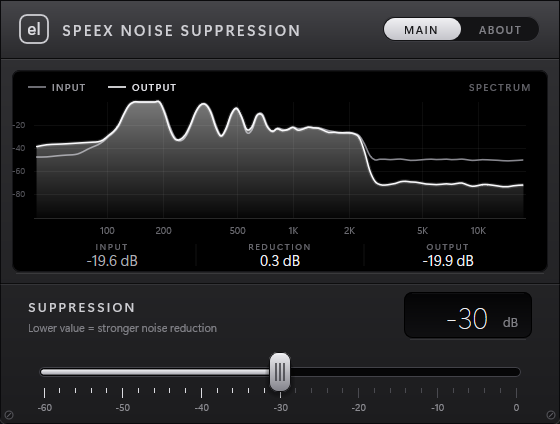

# Speex Noise Suppression: VST3 plugin

**The OBS "Noise Suppression (Speex)" microphone filter as a VST3 plugin for Windows.**
Works in Elgato **Wave Link** and any other VST3 host. Lightweight, runs on weak PCs.



## Why

OBS has a great low-CPU noise suppressor built on [SpeexDSP](https://github.com/xiph/speexdsp), but
only inside OBS. This plugin makes the same filter available everywhere VST3 is supported, for
example as a microphone effect in Wave Link, so you get the same clean mic in calls, Discord and games.

## Features

- Same algorithm and settings as OBS: Speex denoise, **Suppression Level 0 to -60 dB**
  (default -30), AGC / VAD / dereverb off
- Mono and stereo, any sample rate (processes in 10 ms frames, like OBS: 10 ms latency)
- Live **spectrum analyzer**: input vs. output, with input / output / reduction levels
- Smooth slider with fine adjust (hold **Shift**), mouse wheel, or click the value and **type it in**
- GPU-accelerated interface (Direct2D), almost no CPU: the audio part is tiny and the
  analyzer only runs while the window is open

## Install

1. Download the zip from [Releases](../../releases/latest).
2. Copy the `SpeexNoiseSuppression.vst3` folder to `C:\Program Files\Common Files\VST3\`
3. Restart your host (for Wave Link: add a **VST effect** to the microphone channel and pick
   *Speex Noise Suppression*).

Windows 10/11, 64-bit.

## Build from source

Needs Visual Studio 2022 (Desktop C++ workload) and CMake 3.25+.

```bash
git clone --recurse-submodules https://github.com/elem3n7ary/speex-noise-suppression-vst3
cd speex-noise-suppression-vst3
cmake -S . -B build -G "Visual Studio 17 2022" -A x64
cmake --build build --config Release
```

The plugin appears in `build/VST3/Release/`.

## License

[GPL-3.0-or-later](LICENSE). Copyright (C) 2026 elem3n7ary.
Uses [SpeexDSP](https://github.com/xiph/speexdsp) (BSD-3-Clause) and the
[Steinberg VST3 SDK](https://github.com/steinbergmedia/vst3sdk) (MIT), see
[THIRD_PARTY_LICENSES](THIRD_PARTY_LICENSES). Not affiliated with OBS Project, Elgato or Xiph.Org.

VST is a trademark of Steinberg Media Technologies GmbH.
